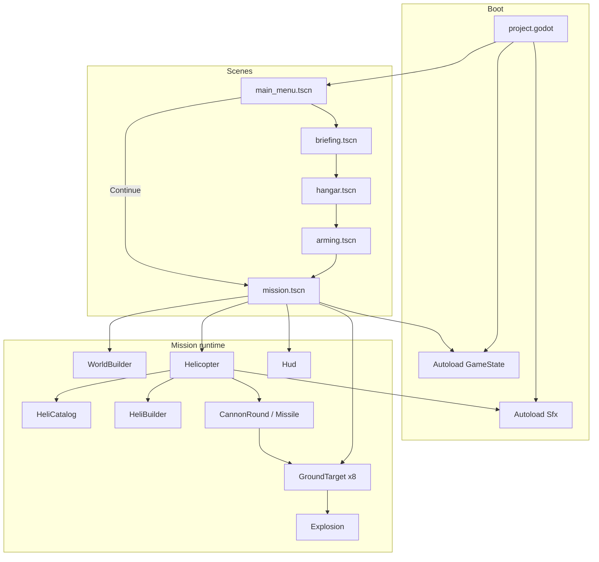
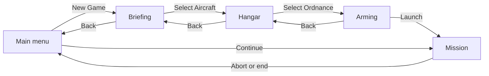
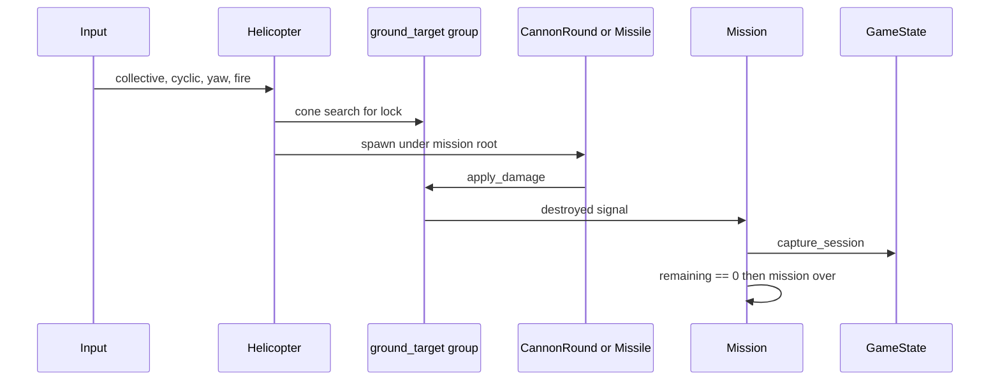
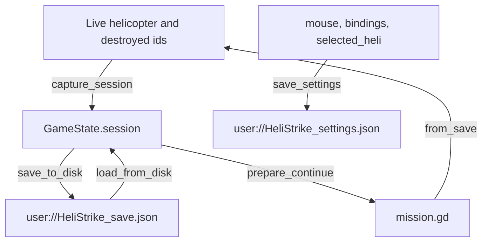

# Architecture

HeliStrike is a single-player Godot 4.6 flight game. One mission, **Operation Iron Hawk**, is played from a procedurally built desert map. Almost every node, mesh, and control is created in GDScript. The `.tscn` files are thin entry points that attach a script to a root node.

There is no network layer, database, or external service. Persistence is two JSON files under Godot’s `user://` directory.

## System overview



## Scene flow

`run/main_scene` is `res://scenes/ui/main_menu.tscn`.



| Scene | Root | Responsibility |
| --- | --- | --- |
| `scenes/ui/main_menu.tscn` | `Node3D` | Preview helicopter, new game, continue, save, settings, quit |
| `scenes/ui/briefing.tscn` | `Control` | Operation Iron Hawk text and schematic map |
| `scenes/ui/hangar.tscn` | `Node3D` | Cycle the three airframes and commit `selected_heli` |
| `scenes/ui/arming.tscn` | `Control` | Mount one store on each pylon, then launch |
| `scenes/world/mission.tscn` | `Node3D` | Terrain, aircraft, targets, HUD, pause, win and fail |

Continue loads the in-memory session if one exists, otherwise the disk save, then opens the mission directly. A new game always goes briefing, then hangar, then ordnance, then a fresh mission. Entering the hangar clears `destroyed_ids` and the saved helicopter pose. Pylon count comes from the airframe: Defender 2, Bell 222 3, Apache 4.

## Key modules

### Session and input — `scripts/autoload/game_state.gd`

Autoload singleton. Owns settings, key bindings, the selected airframe, and the mission snapshot.

- Registers every flight action on the `InputMap` at startup, then applies saved bindings.
- Listens for `pause` outside the mission and calls `toggle_pause()` on the node in group `mission`.
- `process_mode` is `PROCESS_MODE_ALWAYS`, so pause input still works while the tree is paused.

### Audio — `scripts/audio/sfx.gd`

Autoload singleton. Synthesizes 8-bit `AudioStreamWAV` clips at startup (rotor loop, cannon, missile, explosion, UI click). Callers play them through short-lived `AudioStreamPlayer` or `AudioStreamPlayer3D` nodes.

### Aircraft

| Script | Role |
| --- | --- |
| `HeliCatalog` | Static specs for `apache`, `defender`, and `bell222`: thrust, speed, pylon count, hull, rotor rate, copy |
| `MissileCatalog` | Stores mounted on those pylons: single or cluster, damage, range, guidance |
| `HeliBuilder` | Procedural meshes. `build_model()` is the menu and hangar preview. `attach()` parents the same airframe onto a live `Helicopter` and wires cameras, hardpoints, collision, and the ground ray |
| `Helicopter` | `CharacterBody3D` flight, weapons, lock-on, damage, and save snapshot |

Flight step (`Helicopter._physics_process`):

1. Collective from `collective_up` / `collective_down`.
2. Cyclic from keys and, when mouse steering is on, captured mouse motion. The stick eases back toward center.
3. Yaw from `yaw_left` / `yaw_right`.
4. Thrust along local up, gravity, ground-effect boost below 8 m, and a speed cap from the catalog.
5. Ground probe via `RayCast3D`. A hard impact (`speed > 22` and `velocity.y < -8` while near the ground) destroys the aircraft.
6. Lock the nearest living `ground_target` inside a 7° cone and 1600 m. Lock completes at 0.75 s.
7. Cannon is held-fire. Keys 1-4 select a pylon. Each missile trigger fires one round from that pylon, including rockets left in a cluster. Guided stores home only when `has_lock()` is true. Unguided stores fly the aim point plus a small spread, and every round dies at its own range.

Catalog `pitch_rate` and `roll_rate` are stored on the aircraft. The flight step currently uses fixed cyclic rates (`0.95` pitch, `1.15` roll) and only reads catalog values for yaw, thrust, speed, weapons, and rotor spin.

### World and mission

`WorldBuilder` generates a 129×129 heightmap (`FastNoiseLite` seed `17`, 16 m spacing), a skydome, sun, terrain collision on physics layer `world`, and the FOB pad at the origin. `height_at(x, z)` bilinear-samples that grid so targets and the spawn pad sit on the mesh.

`mission.gd` is the match controller:

- Spawns eight targets (three tanks, two SAMs, two radars, one bunker) and skips ids already in `destroyed_ids`.
- Spawns the helicopter at the pad. If `GameState.restore_on_start` is set, it restores pose, velocity, ammo, and hull from the session.
- Tracks remaining targets. Zero remaining, or a crash signal, ends the mission.
- On each kill and on pause, writes a session snapshot through `GameState.capture_session()`.
- Win deletes the disk save and clears the session. A crash leaves the session in place.

### Combat objects

| Class | Base | Notes |
| --- | --- | --- |
| `GroundTarget` | `StaticBody3D` | `Kind` enum: tank, SAM, radar, bunker. `apply_damage()` hides and frees the node at 0 HP |
| `CannonRound` | `Area3D` | Ballistic, 18 damage, 2.2 s life |
| `Missile` | `Area3D` | Damage, speed, guidance, and max range come from `MissileCatalog` |
| `Explosion` | `Node3D` | One-shot `GPUParticles3D` plus a short light and the explosion clip |
| `Hud` | `CanvasLayer` | Live heading, hull, altitude, speed, selected store, rounds left, lock range, compass, collective, and radar |

### UI chrome

`ThemeUtil` is a static factory for the olive and amber military palette, monospace labels, buttons, and panels. `ControlsScreen` is the rebinding overlay used from the pause menu. It writes through `GameState.assign_binding()` and `clear_binding()`. The main menu settings panel writes mouse sensitivity, mouse steering, invert Y, and fullscreen directly onto `GameState` and calls `save_settings()`.

## Data flow

### Mission tick



### Save and restore



Session fields written by the mission:

| Field | Meaning |
| --- | --- |
| `active` | Session can be continued or saved |
| `mission_id` | Always `iron_hawk` |
| `time_sec` | Mission clock, advanced in `Mission._process` |
| `destroyed_ids` | Target ids already removed |
| `heli_id` | `apache`, `defender`, or `bell222` |
| `loadout` | Missile id per pylon, chosen on the ordnance screen |
| `heli` | Pose, basis, velocity, collective, ammo, rounds left on each pylon, selected pylon, hull, camera, flight time |
| `saved_at` | Added only when writing to disk |

`restore_on_start` is true only when a session was loaded from disk and contains a helicopter snapshot. An in-memory continue also restores when `heli` is non-empty.

Settings file fields: `mouse_sensitivity`, `mouse_steering`, `invert_y`, `fullscreen`, `bindings`, `selected_heli`.

Bindings are two slots per action. Each slot is `{"t": "k"|"m", "c": code}` or `null`. `k` is a physical keycode, `m` is a mouse button.

## Physics layers

Named in `project.godot`. Bit values are what the scripts assign.

| Layer | Name | Bit | Who uses it |
| --- | --- | --- | --- |
| 1 | `world` | 1 | Terrain and FOB static bodies |
| 2 | `helicopter` | 2 | `Helicopter` body. Mask is world plus targets (`1 \| 8`) |
| 3 | `projectiles` | 4 | Cannon rounds and missiles. Mask is world plus targets |
| 4 | `targets` | 8 | `GroundTarget` body and its `Area3D` |

## Groups

| Group | Members | Used by |
| --- | --- | --- |
| `mission` | Mission root | `GameState` pause routing |
| `heli` | Live helicopter | Reserved for lookups |
| `ground_target` | Living targets | Lock search. Removed on death |

## File structure

```
HeliStrike/
  project.godot          Engine name, autoloads, display, physics, rendering
  icon.svg
  docs/                  Project documentation
  scenes/
    ui/                  main_menu, briefing, hangar, arming
    world/               mission
  scripts/
    autoload/            game_state.gd
    audio/               sfx.gd
    helicopter/          helicopter.gd, heli_builder.gd, heli_catalog.gd
    world/               mission.gd, world_builder.gd
    targets/             ground_target.gd
    weapons/             cannon_round.gd, missile.gd, missile_catalog.gd
    fx/                  explosion.gd
    ui/                  main_menu, briefing, hangar, arming, hud, controls_screen, theme_util
```

`.godot/` is the editor cache and is gitignored. Do not commit it.

## Conventions that shape the architecture

- Scenes stay empty on purpose. Add behavior in the matching script, not by stacking nodes in the editor, unless a node must be saved as a resource.
- Global types use `class_name`. Autoloads (`GameState`, `Sfx`) do not, because the autoload name is the API.
- Factories that do not enter the tree (`HeliCatalog`, `HeliBuilder`, `WorldBuilder`, `ThemeUtil`) extend `RefCounted`.
- Cross-scene state goes through `GameState`. Do not stash mission progress on a UI node.
